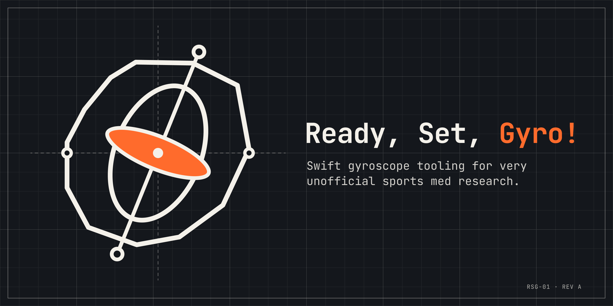

 
# Ready, Set, Gyro!
 
A Swift framework and iOS app for working with gyroscope data in sports medicine research. It's an experiment, and I'm building it on my own.
 
## Where things stand
 
Nothing is built yet. This org is where the work will live as it happens, so for now it's mostly a plan and an empty set of repos.
 
## What it's going to be
 
- **A framework** for reading and processing motion data in Swift
- **An app** built on top of it, so the framework gets used for something real
Both will be developed in the open under this org.
 
## Why
 
I wanted to see how far phone-grade motion sensors can go for sports medicine research, and building it was the best way to find out. Expect rough edges and changed minds.
 
## Contributing
 
It's a one-person project right now. Issues and ideas are welcome. I'll probably hold off on pull requests until there's something to review.
